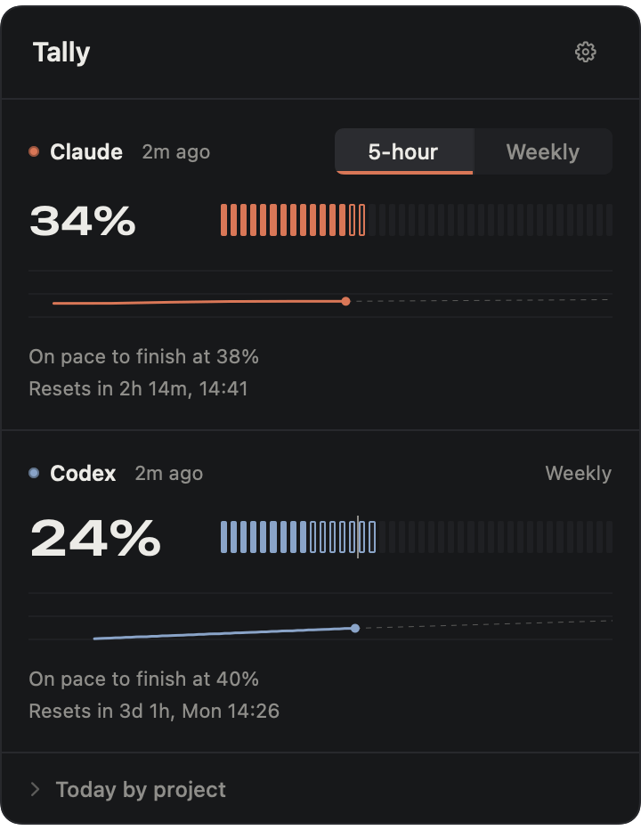

# Tally

Claude and Codex plan usage in the menu bar, as two tiny level bars.

<p align="center"></p>

<p align="center">    </p>

Requires macOS 15 or later.

## What it does
- Two level bars in the menu bar, one per service.
- Click for a wide LED bar (5-hour or weekly) with the pace outlined ahead of it.
- A forecast line: at the current pace, where you'll be at reset, or when you'll run out.
- Reset time, per-model weekly limits and a history strip.
- Old readings stay visible, dimmed and marked with their age.
- Today's use against a daily budget; after a restart it keeps counting from the last reading before midnight.
- Alerts at 80% and 95% of the 5-hour and weekly limits, when a limit resets, and on sudden jumps (10 points in 15 minutes). Each can be switched off in Settings.
- Today's fresh tokens per project, from local transcripts (cache reads aren't counted). Works without plan readings if you only use the Claude desktop app.

## Install

**Homebrew**

```
brew tap noterikkirillov8/tap
brew trust noterikkirillov8/tap
brew install --cask tally
```

**Download**: get `Tally-1.0.0.zip` from [Releases](https://github.com/noterikkirillov8/tally/releases), unzip it and drag `Tally.app` to Applications.

**Build from source**: see below.

Tally isn't notarised by Apple (that needs a paid developer account), so the first time macOS may say it can't verify the developer: open System Settings → Privacy & Security, scroll down and click Open Anyway (on macOS 15 and later right-click → Open no longer works). The Homebrew cask clears that flag for you.

## How it works
By default Tally reads the rate limits Claude Code's status line writes to `~/.claude/cache/usage-latest.json` and the newest rate-limit event in `~/.codex/sessions`. Both are local files. After 15 minutes, the last reading dims and the panel shows its age. After 7 days, the panel shows “No recent reading” instead. If Claude Code isn't set up, the panel offers a Set up key that copies a 3-line status line helper to your clipboard; Tally never edits your Claude Code settings. An optional switch, "Live Claude numbers" (off by default), reads Claude Code's sign-in from your Keychain once macOS asks (or from `~/.claude/.credentials.json`), and sends it only to api.anthropic.com.

## Privacy
No network and no Keychain access unless you turn on Live Claude numbers; then only api.anthropic.com is contacted, with your own Claude Code token. If that service rate-limits, Tally waits (2, 4, 8, then 30 minutes) before asking again. Alerts are local notifications. No telemetry, no update checks.

## Build from source
Needs Xcode 16+ and [XcodeGen](https://github.com/yonaskolb/XcodeGen).

```
scripts/test.sh                  # tests
NO_OPEN=1 scripts/install.sh      # build Release and install to /Applications
```
`scripts/install.sh` signs with the author's local certificate if you have it, and ad hoc otherwise, so it works on any Mac.

## Credits
MIT licence. Interface sounds by Kenney (kenney.nl), CC0.

---
Part of Patchbay: [Harbor](https://github.com/noterikkirillov8/harbor) / [Tally](https://github.com/noterikkirillov8/tally) / [Sweep](https://github.com/noterikkirillov8/sweep) / [Ledge](https://github.com/noterikkirillov8/ledge) / [Switchboard](https://github.com/noterikkirillov8/switchboard) / [Shutter](https://github.com/noterikkirillov8/shutter) / [Reel](https://github.com/noterikkirillov8/reel) / [Vigil](https://github.com/noterikkirillov8/vigil)
